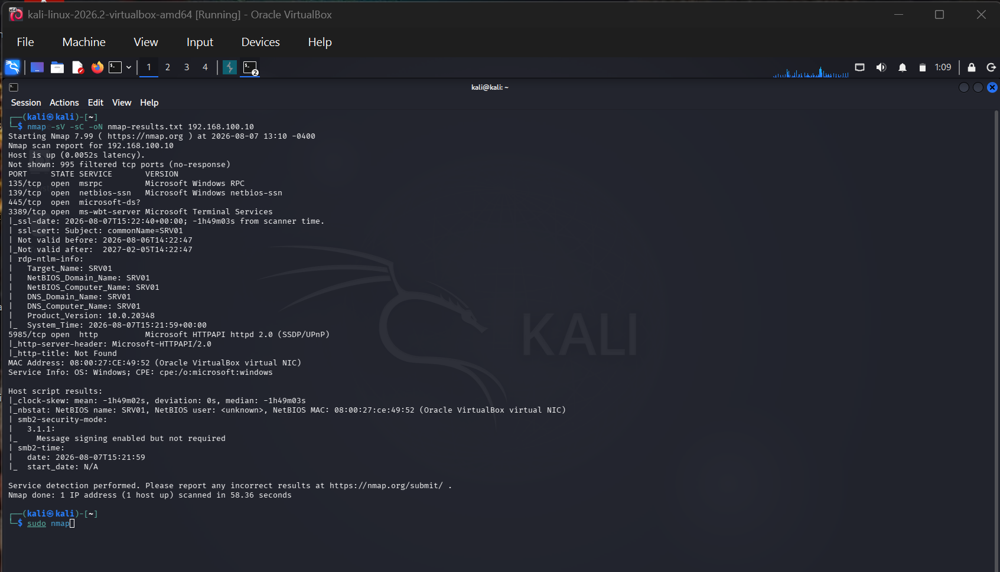

# Nmap Network Scan

## Objective
Perform reconnaissance against the Windows Server 2022 target VM in the home lab to identify
open ports, running services, and potential attack surface.

## Scope
Isolated internal lab network only — `192.168.100.0/24`. Kali (192.168.100.20) scanning
Windows Server 2022 (192.168.100.10). No traffic left the internal VirtualBox network.

## Command Used

```bash
nmap -sV -sC -oN nmap-results.txt 192.168.100.10
```

## Full Output

```
Starting Nmap 7.99 ( https://nmap.org ) at 2026-08-07 13:10 -0400
Nmap scan report for 192.168.100.10
Host is up (0.0052s latency).
Not shown: 995 filtered tcp ports (no-response)
PORT     STATE SERVICE       VERSION
135/tcp  open  msrpc         Microsoft Windows RPC
139/tcp  open  netbios-ssn   Microsoft Windows netbios-ssn
445/tcp  open  microsoft-ds?
3389/tcp open  ms-wbt-server Microsoft Terminal Services
| ssl-date: 2026-08-07T15:22:40+00:00; -1h49m03s from scanner time.
| ssl-cert: Subject: commonName=SRV01
| Not valid before: 2026-08-06T14:22:47
|_Not valid after:  2027-02-05T14:22:47
| rdp-ntlm-info:
|   Target_Name: SRV01
|   NetBIOS_Domain_Name: SRV01
|   NetBIOS_Computer_Name: SRV01
|   DNS_Domain_Name: SRV01
|   DNS_Computer_Name: SRV01
|   Product_Version: 10.0.20348
|_  System_Time: 2026-08-07T15:21:59+00:00
5985/tcp open  http          Microsoft HTTPAPI httpd 2.0 (SSDP/UPnP)
|_http-server-header: Microsoft-HTTPAPI/2.0
|_http-title: Not Found
MAC Address: 08:00:27:CE:49:52 (Oracle VirtualBox virtual NIC)
Service Info: OS: Windows; CPE: cpe:/o:microsoft:windows

Host script results:
|_clock-skew: mean: -1h49m02s, deviation: 0s, median: -1h49m03s
|_nbstat: NetBIOS name: SRV01, NetBIOS user: <unknown>, NetBIOS MAC: 08:00:27:ce:49:52 (Oracle VirtualBox virtual NIC)
| smb2-security-mode:
|   3.1.1:
|_    Message signing enabled but not required
| smb2-time:
|   date: 2026-08-07T15:21:59
|_  start_date: N/A

Nmap done: 1 IP address (1 host up) scanned in 58.36 seconds
```

## Findings

| Port | State | Service | Version / Notes |
|------|-------|---------|------------------|
| 135  | open  | msrpc | Microsoft Windows RPC |
| 139  | open  | netbios-ssn | Microsoft Windows netbios-ssn |
| 445  | open  | microsoft-ds | SMB — see [project 05](../05-smb-enumeration) for follow-up |
| 3389 | open  | ms-wbt-server | RDP — hostname `SRV01`, self-signed cert |
| 5985 | open  | http (WinRM) | Microsoft-HTTPAPI/2.0 |

### Observations
- **RDP (3389) is open and reachable** — in a real environment this is a common target for
  brute-force and credential-stuffing attacks. It should be restricted to a VPN or jump host,
  not exposed directly.
- **SMB signing is "enabled but not required"** (`smb2-security-mode`) — this is a real,
  flaggable finding. Without required signing, SMB traffic is vulnerable to relay attacks.
  Recommended fix: enforce SMB signing via Group Policy.
- **Clock skew of ~1h49m** between scanner and target — worth checking NTP configuration,
  since significant time drift can break Kerberos authentication in a domain environment.
- **Port 5985 (WinRM)** being open means remote PowerShell management is enabled — useful
  operationally, but another authentication surface to secure.
- Follow-up SMB vulnerability and share enumeration scans are documented in
  [project 05](../05-smb-enumeration).

## Skills Gained
- Nmap syntax and scan types (service detection `-sV`, default scripts `-sC`)
- Reading and interpreting scan output, including NSE script results
- Identifying real, reportable security findings (SMB signing, exposed RDP) rather than just
  listing open ports
- Documenting reconnaissance findings in a clear, actionable format

## Screenshot


