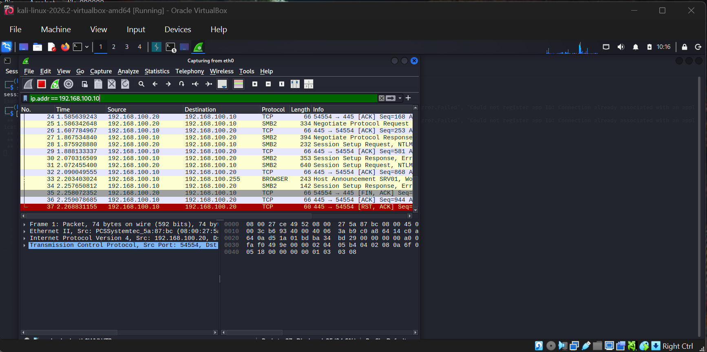
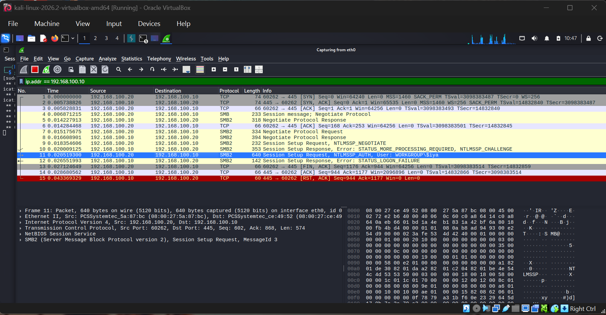
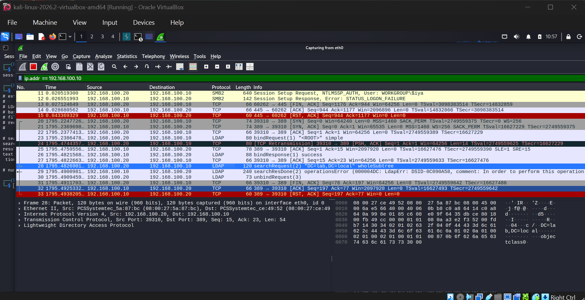
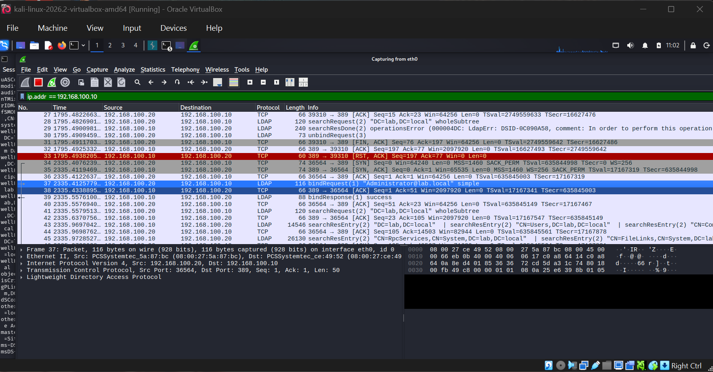

# Traffic Capture & Analysis

## Objective
Capture live network traffic on the home lab while performing SMB and LDAP authentication
attempts, then analyze it in Wireshark to see exactly what's visible on the wire during both
failed and successful authentication — from a defender's perspective.

## Scope
Isolated internal lab network only — `192.168.100.0/24`. Traffic captured on Kali's `eth0`
interface, filtered to `ip.addr == 192.168.100.10` (the Windows Server / domain controller).

## Setup
```
Capture filter: eth0 interface
Display filter: ip.addr == 192.168.100.10
```
Two rounds of capture were run: one against SMB (before AD promotion) and one against LDAP
(after promoting the server to a domain controller for `lab.local`).

## Test 1 — SMB Authentication Attempts

Ran `smbclient` against the target with intentionally incorrect decoy credentials, twice, while
capturing traffic:
```bash
smbclient -L //192.168.100.10 -U 'jdoe%P@ss0rd123!'
smbclient -L //192.168.100.10 -U '$iya%Moyo@123'
```

**What the capture showed:**
- Full TCP three-way handshake, then an initial SMB1 negotiation attempt that fell back to SMB2
- `Session Setup Request, NTLMSSP_AUTH, User: WORKGROUP\$iya` followed immediately by
  `Session Setup Response, Error: STATUS_LOGON_FAILURE`
- Connection teardown via `FIN, ACK` then `RST, ACK`

**Key finding**: the attempted **username is visible in cleartext** in the packet data even
when the login fails. An attacker sniffing the network doesn't need a successful login to
learn valid (or attempted) usernames — that alone is useful reconnaissance.




## Test 2 — LDAP Queries Against the Domain Controller

After promoting the server to a domain controller, tested two LDAP access patterns:

```bash
# Anonymous query
ldapsearch -x -H ldap://192.168.100.10 -b "DC=lab,DC=local"

# Authenticated query with real Administrator credentials
ldapsearch -x -H ldap://192.168.100.10 -D "Administrator@lab.local" -w '<redacted>' -b "DC=lab,DC=local"
```

**What the capture showed:**
- The anonymous attempt's `bindRequest` actually **succeeds** (`bindResponse(1) success`) —
  anonymous *binding* is allowed — but the subsequent `searchRequest` fails with
  `operationsError`. So the correct finding is: anonymous bind is permitted, but anonymous
  searches are blocked. Worth noting precisely, since "LDAP blocks anonymous access" would be
  an oversimplification.
- The **authenticated** bind is a different story: Wireshark decoded the raw packet bytes and
  showed the full bind DN **and password in plaintext** — `Administrator@lab.local` /
  `<redacted>`. This is because standard LDAP (port 389) is unencrypted by default.




> **Note on handling this finding responsibly**: the original screenshots showed my actual lab
> domain admin password in plaintext, since that's the entire point of the finding. Before
> committing them to this public repo, I redacted the password out of both the hex/ASCII pane
> and the terminal command history. This is standard practice — the *finding* (LDAP transmits
> credentials in cleartext) is the valuable part, not the specific secret. Always redact real
> credentials, even lab ones, before publishing screenshots.

## Findings Summary

| Observation | Risk | Recommendation |
|---|---|---|
| Attempted usernames visible in cleartext during failed SMB/NTLM auth | Low-Medium — aids reconnaissance | Monitor for repeated failed auth attempts; consider account lockout policies |
| Anonymous LDAP bind permitted (searches blocked) | Low — matches expected AD default | Confirm this is intentional; disable anonymous bind entirely if not needed |
| LDAP simple bind transmits full username **and password** in plaintext | **High** | Enforce LDAPS (port 636) or LDAP with StartTLS for all bind operations; never allow plaintext LDAP auth on a production network |
| No account lockout policy configured (`lockoutThreshold: 0`) | Medium | Configure account lockout after N failed attempts to slow brute-force attacks |

## Skills Gained
- Wireshark capture and display filters (`ip.addr`)
- Reading TCP handshakes, connection teardown, and SMB2/LDAP protocol exchanges at the packet level
- Correlating captured traffic with the specific command/action that generated it
- Identifying and articulating real security findings (cleartext credentials, missing lockout
  policy) rather than just describing packet contents
- Practicing responsible disclosure hygiene — redacting real credentials before publishing
  security research, even from an isolated personal lab

## Next Steps
- Re-run the LDAP bind test after configuring LDAPS, and compare the packet capture to confirm
  credentials are no longer visible
- Configure an account lockout policy and re-test the failed-login scenario to observe the
  difference in Windows Event Log / Wireshark output

