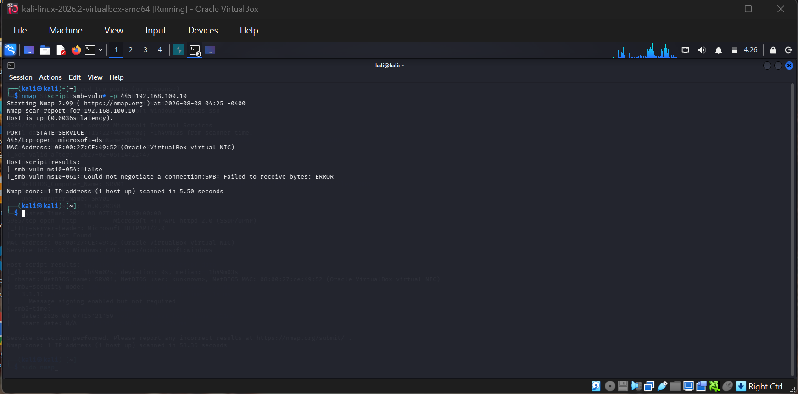
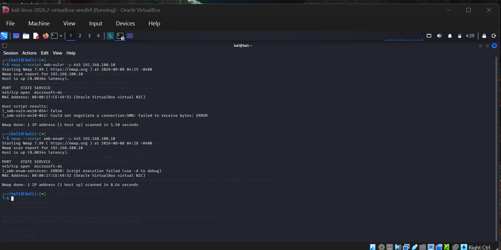
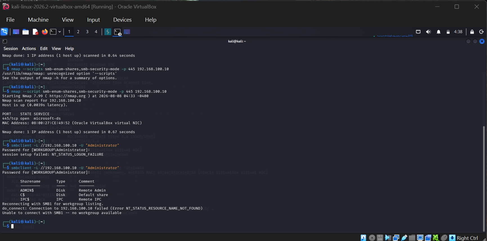
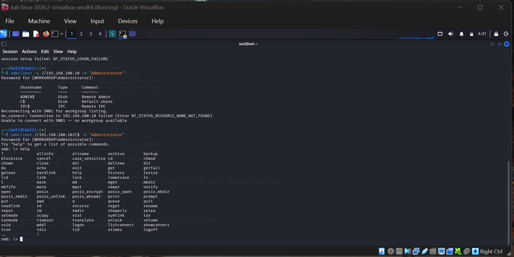
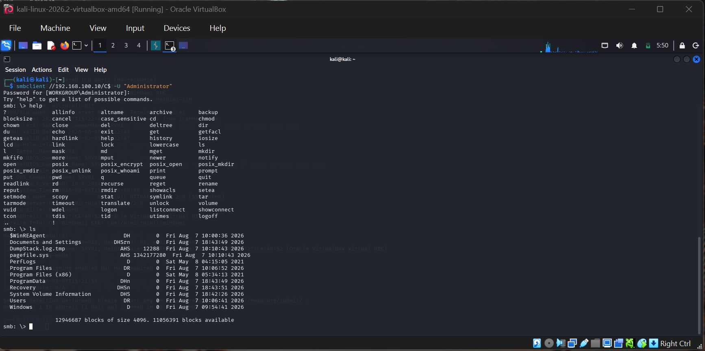

# SMB Enumeration & Share Access

## Objective
Follow up on the SMB service found open during the [Nmap scan](../02-nmap-scan) — probe it for
known vulnerabilities, enumerate available shares, and (with valid lab credentials) inspect
what an authenticated user can actually access on the box.

## Scope
Isolated internal lab network only — `192.168.100.0/24`. All credentials used belong to the
lab's own Administrator account, created and controlled by me.

## Steps & Commands

### 1. SMB vulnerability scan
```bash
nmap --script smb-vuln* -p 445 192.168.100.10
```
Result: no confirmed vulnerabilities from the tested scripts (`smb-vuln-ms10-054`: false,
`smb-vuln-ms10-061`: could not negotiate). Windows Server 2022 isn't vulnerable to these
older SMB exploits, which is expected — it's a useful baseline check regardless.

### 2. SMB share/service enumeration
```bash
nmap --script smb-enum-services -p 445 192.168.100.10
nmap --script smb-enum-shares,smb-security-mode -p 445 192.168.100.10
```
The `smb-enum-services` script failed against this target (Windows Server 2022 restricts the
information this script relies on by default) — that's a valid finding in itself: default
hardening on modern Windows Server blocks some classic enumeration techniques.

### 3. Authenticated share listing with smbclient
```bash
smbclient -L //192.168.100.10 -U "Administrator"
```
An anonymous/incorrect attempt first failed with `NT_STATUS_LOGON_FAILURE`, then a correct
authenticated attempt listed the available shares:

| Sharename | Type | Comment |
|-----------|------|---------|
| ADMIN$    | Disk | Remote Admin |
| C$        | Disk | Default share |
| IPC$      | IPC  | Remote IPC |

### 4. Connecting into a share and browsing
```bash
smbclient //192.168.100.10/C$ -U "Administrator"
smb: \> ls
smb: \> cd Users/Administrator/Desktop
smb: \> ls
```
Successfully browsed the full C: drive listing, then navigated into
`Users\Administrator\Desktop` (after correcting an initial path typo — Windows-style
backslashes don't always translate directly in the smbclient shell).

## Findings

- **Default admin shares (`ADMIN$`, `C$`) are enabled**, which is standard on Windows but worth
  noting: with valid Administrator credentials, an attacker gets full filesystem access over
  the network with no additional exploitation needed.
- **Anonymous enumeration is blocked** — the first `smbclient` attempt without valid credentials
  correctly failed. That's good baseline security.
- **`smb-enum-services` being blocked** shows Windows Server 2022's default hardening is more
  effective than older Windows/Samba-era assumptions — a useful contrast to older CVEs like
  MS10-054/061 which no longer apply here.
- **Takeaway for defenders**: the real risk here isn't a vulnerability in SMB itself, it's what
  happens *after* credentials are compromised. This reinforces why credential hygiene and
  limiting local admin rights matters more than patching alone.

## Skills Gained
- Nmap NSE scripting (`smb-vuln*`, `smb-enum-shares`, `smb-security-mode`)
- Authenticated SMB enumeration using `smbclient`
- Interpreting failed vs. successful authentication attempts as security signal
- Navigating a remote filesystem over SMB and documenting access scope

## Screenshots





