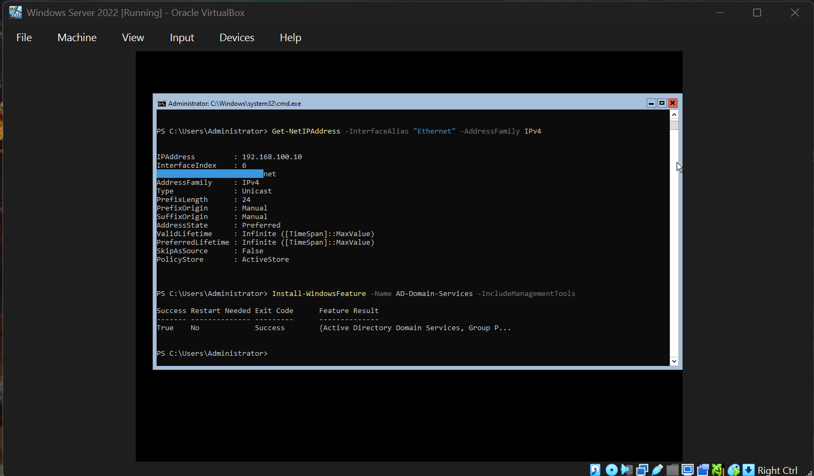
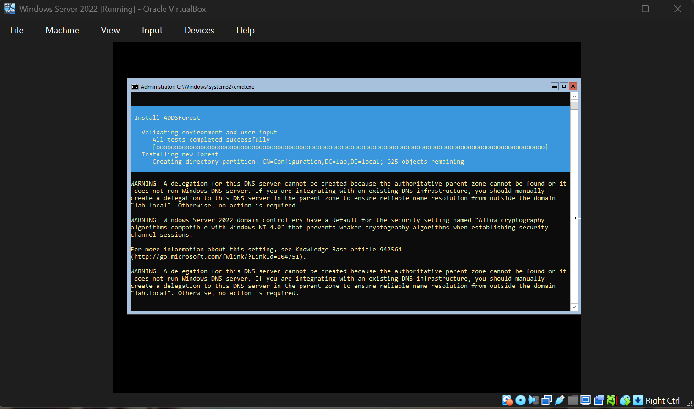

# Active Directory Domain Controller Setup

## Objective
Extend the home lab beyond a standalone server by promoting the Windows Server 2022 VM to a
full Active Directory Domain Controller — the foundation most real-world enterprise
environments (and most attack paths red/blue teamers study) are built on.

## Steps & Commands

### 1. Install the AD DS role
```powershell
Install-WindowsFeature -Name AD-Domain-Services -IncludeManagementTools
```
Result: `Success = True`, feature installed — `{Active Directory Domain Services, Group P...}`

### 2. Promote the server to a new forest
```powershell
Install-ADDSForest
```
Created a new forest and domain: **`lab.local`**

Setup output confirmed:
- Environment validation: all tests passed
- New forest installation, creating directory partition `CN=Configuration,DC=lab,DC=local`
- Standard warnings noted (expected in an isolated lab, not actionable):
  - No external DNS delegation for `lab.local` — expected, since this domain doesn't need to
    resolve from outside the isolated lab network
  - Default "Allow cryptography algorithms compatible with Windows NT 4.0" security setting
    flagged — a legitimate hardening note for a production environment, tracked as a follow-up

## Why This Matters
A huge share of real-world enterprise compromises involve Active Directory in some way —
Kerberoasting, privilege escalation via misconfigured group memberships, lateral movement
using SMB/RDP within a domain, and so on. Having an actual AD environment to test against
(rather than just a standalone box) makes every future project in this lab more realistic:
Nmap scans, SMB enumeration, and future projects can now be run against domain-joined systems
instead of an isolated workgroup machine.

## Next Steps
- Join the Kali VM (or a second Windows client VM) to the `lab.local` domain
- Create test user accounts with varying privilege levels
- Re-run the Nmap and SMB enumeration projects against the domain controller and compare
  findings to the standalone-server results in [project 02](../02-nmap-scan) and
  [project 05](../05-smb-enumeration)
- Explore basic AD enumeration tools (e.g. `enum4linux`, PowerView) against the new domain

## Skills Gained
- Windows Server role installation via PowerShell
- Promoting a server to a Domain Controller (`Install-ADDSForest`)
- Understanding forest/domain structure and initial AD DS configuration
- Reading and triaging setup warnings (distinguishing "expected in a lab" from "real hardening
  concern")

## Screenshots


